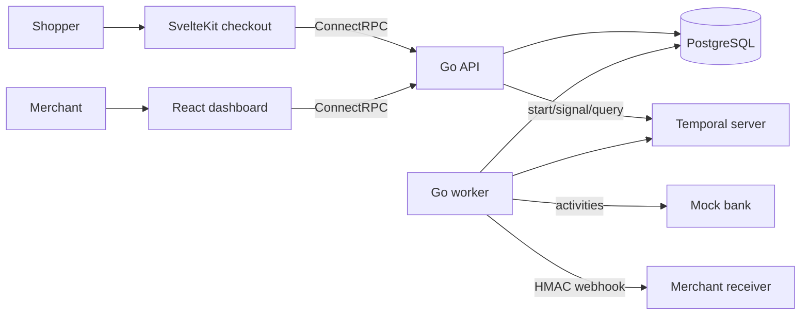

# Pay-by-Bank Checkout

[](https://github.com/mini4141/pay-by-bank-checkout/actions/workflows/ci.yml)

An end-to-end pay-by-bank payment flow. A merchant creates a checkout, the shopper pays from their (mock) bank account in a SvelteKit checkout, a Temporal workflow runs the payment end to end, and the merchant sees it settle live in a React dashboard. The API is typed end to end with Protobuf and ConnectRPC.

Built as a portfolio project for a full-stack role in early-stage fintech (TypeScript/SvelteKit, Go, Temporal, PostgreSQL). Breadth of stack over depth of business rules.

## Architecture



| Area | Technology |
|---|---|
| Frontend | TypeScript, SvelteKit 2 + Svelte 5 (checkout, `adapter-node`), React 19 + Vite (dashboard), `connect-web` clients, Vitest, Playwright |
| Backend | Go, ConnectRPC, Protobuf managed with `buf` (lint, breaking, generate for Go + TS), server-streaming `WatchPayment` |
| Workflows | Temporal Go SDK: `PaymentWorkflow`, `RefundWorkflow`, retries, signal, query |
| Data | PostgreSQL 17, `pgx` + `sqlc`, `goose` migrations |
| Cloud | AWS ECS Fargate, ALB, RDS, ECR, CloudWatch, S3 + CloudFront, Cloud Map, all in Terraform |
| CI | GitHub Actions (buf, go test, svelte-check, vitest, builds, Playwright e2e) |

## Quickstart (local)

Prerequisites: Docker Desktop, Go, Node 24 + pnpm, `buf`.

```bash
pnpm install
./scripts/dev-up.sh        # compose: postgres, temporal, api, worker, mockbank, receiver, checkout, dashboard + seed
./scripts/test-all.sh      # lint, unit, integration, Vitest, Playwright
./scripts/dev-down.sh
```

| What | URL |
|---|---|
| Merchant dashboard (API key in `.local/seed.json`) | http://localhost:5173 |
| Shopper checkout (link comes from the dashboard) | http://localhost:3000 |
| Temporal UI | http://localhost:8233 |
| Webhook receiver deliveries | http://localhost:8082/receiver/deliveries |

The demo story: "Kissa Coffee" creates a ¥1,200 checkout, the shopper pays while the bank fails debits (`MOCKBANK_FAIL_RATE=0.5`), the timeline still settles, the Temporal UI shows the retries, the merchant sees the signed webhook and refunds the payment.

## Deploy to AWS and destroy

```bash
./scripts/deploy.sh        # terraform + images + migrations + seed + cloud smoke/e2e (AWS profile pay-by-bank-checkout-deployer)
./scripts/destroy.sh       # empties S3/ECR, scales ECS to 0, terraform destroy
./scripts/verify-destroyed.sh
```

The stack is meant to live for under two hours. Everything is tagged `Project=pay-by-bank-checkout`.

## Docs and proof

- Proof of the system working: [proof/README.md](proof/README.md)
- Write-up: [docs/PORTFOLIO.md](docs/PORTFOLIO.md)
- Design proposals: [0001 payment workflow](docs/design/0001-payment-workflow.md), [0002 idempotency](docs/design/0002-idempotency.md)
- ADRs: [docs/adr](docs/adr), decisions log: [docs/DECISIONS.md](docs/DECISIONS.md), [tech debt](docs/tech-debt.md), [AI usage](docs/AI_USAGE.md)

## Layout

```
proto/pay/v1/    API source of truth (buf)         gen/        generated Go + TS (committed)
services/api     Connect handlers, sqlc, goose     services/worker    Temporal workflows + activities
services/mockbank, services/receiver               web/checkout (SvelteKit), web/dashboard (React)
infra/           Terraform                         e2e/        Playwright
```

## Next step

Mobile (Swift/Kotlin) clients are out of scope for this web showcase, but `buf generate` can emit Connect clients for both from the same protos.
