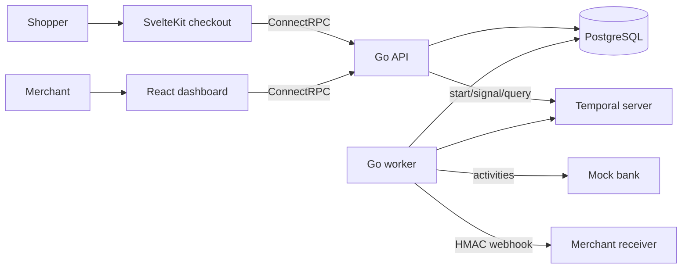

# SPECS.md: Pay-by-Bank Checkout

## 1. Summary

A small but complete **pay-by-bank** product:

- **Merchants** create checkout sessions through an API or the React dashboard.
- **Shoppers** open a SvelteKit checkout, choose their bank, approve the (mock) consent and pay.
- A **Temporal** workflow runs the payment: reserve → risk check → debit → settle to the merchant balance → signed webhook. Each step retries on its own.
- The checkout shows live progress through a ConnectRPC server stream, and the merchant dashboard updates in real time.
- Refunds are a second workflow, triggered from the dashboard.

**Demo story:**
1. The merchant "Kissa Coffee" creates a ¥1,200 checkout.
2. The shopper pays from "Mock Bank" while the bank fails 50% of debit calls.
3. The checkout timeline still shows "Settled". The Temporal UI shows the retries.
4. The merchant sees the payment and the webhook log, and refunds it.

## 2. Requirement coverage matrix

| Requirement | Covered by | Proof |
|---|---|---|
| Features end to end, from UI to services and data models | Checkout (Svelte) → Connect API (Go) → Temporal → Postgres | e2e test |
| Loosely defined problems → plans, design proposals | `docs/design/0001…`, `0002…`, ADRs | Docs |
| Ship-fast vs redesign trade-offs, tech-debt spotting | ADR "status via table vs query", `docs/tech-debt.md` register | Docs |
| Comfortable across the stack | Svelte + React + Go + SQL + infra | Repo |
| Stack: TS/JS, SvelteKit, React, Go, ConnectRPC/Protobuf, Temporal, PostgreSQL, AWS, Terraform | All used | CI + proof |
| Payments domain where correctness matters (nice to have) | Idempotency, minor units, workflow determinism, signed webhooks | Tests |

## 3. Architecture



## 4. Repository layout

```
proto/pay/v1/        checkout.proto, payment.proto, merchant.proto
gen/                 go/, ts/  (buf generate output, committed)
services/api/        Connect handlers, sqlc queries, migrations
services/worker/     Temporal workflows + activities
services/mockbank/   mock bank HTTP API
services/receiver/   demo merchant webhook receiver (stores + shows deliveries)
web/checkout/        SvelteKit app
web/dashboard/       React + Vite app
infra/               Terraform
docs/design/  docs/adr/
```

## 5. Features (end-to-end)

### F1: Merchant onboarding and checkout creation
- RPCs: `MerchantService.CreateMerchant` (returns an API key once), `CheckoutService.CreateCheckout{amount, currency, reference, return_url, idempotency_key}`, which returns `checkout_url`.
- The dashboard has a "New checkout" form and shows the URL and a QR code.
- **Accept:** the checkout URL opens the SvelteKit page with the amount and the merchant name.

### F2: Shopper checkout (SvelteKit)
- Steps: bank selection (3 mock banks) → consent screen (mock bank page inside the flow) → confirm → progress timeline (Reserved ✓, Risk ✓, Debited ✓, Settled ✓) → done / return to the merchant.
- It uses `WatchPayment` streaming.
- **Accept:** the timeline completes without a refresh.

### F3: Payment workflow (Temporal)
- `PaymentWorkflow(paymentID)` runs these activities in order:
  1. `ReserveFunds(bank)`
  2. `RiskCheck` (rule: amount ≤ limit)
  3. `Debit(bank)`, with retry policy: initial 1 s, max 5 attempts
  4. `SettleToMerchant` (ledger rows in Postgres)
  5. `DeliverWebhook` (HMAC, retry up to 10)
- Query handler `status`; signal `cancel` (before debit). On a failed risk check it releases the reservation (compensation).
- **Accept:** with `MOCKBANK_FAIL_RATE=0.5` the payment still settles, and the history shows retried activities.

### F4: Merchant dashboard (React)
- Payments table (live via `WatchMerchantPayments` stream), payment detail (timeline + webhook deliveries), refund button, and a balance tile.
- **Accept:** a new payment appears live, and its detail lists the webhook attempt(s).

### F5: Refunds
- `RefundWorkflow` credits the shopper's bank (mock) and debits the merchant ledger, then sends the `payment.refunded` webhook.
- **Accept:** the status becomes REFUNDED and the balance decreases.

### F6: Design documents
- `0001-payment-workflow.md`: problem, constraints, options (sync API vs queue vs Temporal), decision, failure modes, rollout. `0002-idempotency.md`. ADRs for the status-propagation choice.
- **Accept:** the docs exist and are linked from the README.

## 6. Data model

- `merchants(id, name, api_key_hash, webhook_url, webhook_secret)`
- `checkouts(id, merchant_id, amount_minor, currency, reference, status, idempotency_key UNIQUE)`
- `payments(id, checkout_id, bank, status, workflow_id, created_at, updated_at)`
- `payment_events(id, payment_id, step, status, at)`
- `ledger_entries(id, merchant_id, payment_id, amount_minor, kind)`
- `webhook_deliveries(id, payment_id, attempt, status_code, at)`

## 7. Interfaces

These are ConnectRPC services, served over HTTP/1.1 + JSON or binary:

| Service | RPCs |
|---|---|
| `MerchantService` | `CreateMerchant`, `GetBalance` |
| `CheckoutService` | `CreateCheckout`, `GetCheckout` |
| `PaymentService` | `StartPayment`, `WatchPayment` (stream), `ListPayments`, `WatchMerchantPayments` (stream), `RefundPayment` |

The mock bank serves `/consent`, `/reserve`, `/debit`, `/credit` and `/admin/fail-rate`.

## 8. Test plan

| Layer | Test |
|---|---|
| Go/Temporal | Workflow happy path (testsuite with mocked activities); Debit retried after one error |
| Go/sqlc | Insert + read a payment |
| Vitest | Svelte timeline renders steps; React payments table renders rows |
| Playwright | Full demo story including refund |

## 9. Phase 1: Local

`docker compose` runs postgres, temporal (dev server + UI :8233), api, worker, mockbank, receiver, checkout and dashboard.

- [ ] `tests/`: go test JUnit, vitest, Playwright report
- [ ] `screenshots/01-dashboard-new-checkout.png`, `02-checkout-bank-select.png`, `03-checkout-consent.png`, `04-checkout-timeline-settled.png`, `05-dashboard-live-payment.png`, `06-webhook-deliveries.png`, `07-temporal-ui-history-retries.png`, `08-refunded.png`
- [ ] `logs/worker.log`, `logs/mockbank-failures.log`, `logs/buf-lint.txt`

## 10. Phase 2: AWS

| Local | AWS |
|---|---|
| compose Postgres | RDS PostgreSQL (private, SG from tasks only) |
| containers | ECS Fargate services in public subnets (public IP, no NAT), Cloud Map service discovery between them |
| localhost ports | ALB: `/` → checkout-web, `/api/*` → api (Connect), `/receiver/*` → receiver; listener on :8233 → Temporal UI, SG limited to the deployer IP |
| vite dashboard | S3 + CloudFront, API base set to the ALB DNS name |

`scripts/deploy.sh`:
1. `terraform apply`.
2. Push images.
3. Run migrations (one-off task).
4. Seed the merchant.
5. Playwright against the ALB and CloudFront.

- [ ] `screenshots/01-cloud-checkout-settled.png`, `02-cloud-dashboard.png`, `03-cloud-temporal-ui.png`
- [ ] `logs/ecs-services.json`, `logs/cloudwatch-worker.log`, `resources.txt`
- [ ] `tests/playwright-cloud/`

## 11. Phase 3: Destroy

`terraform destroy`.

`verify-destroyed.sh` checks for no ECS cluster, ALB, RDS instance, CloudFront distribution, ECR repos or Cloud Map namespace.

## 12. Out of scope

Real bank APIs / open-banking certification, Swift/Kotlin apps, KYC, multi-currency FX, and Temporal Cloud.
