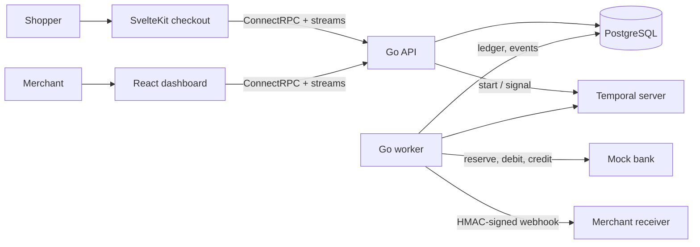
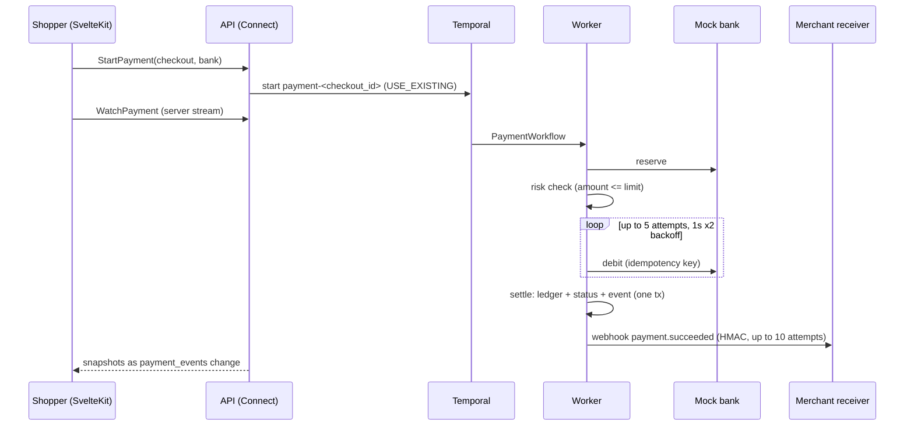
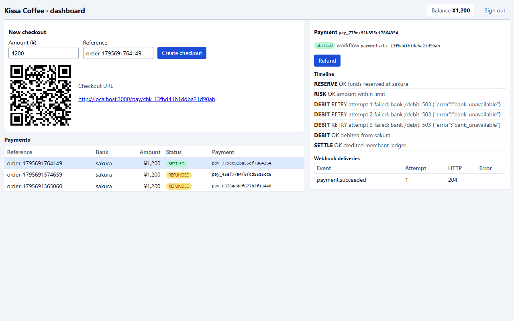
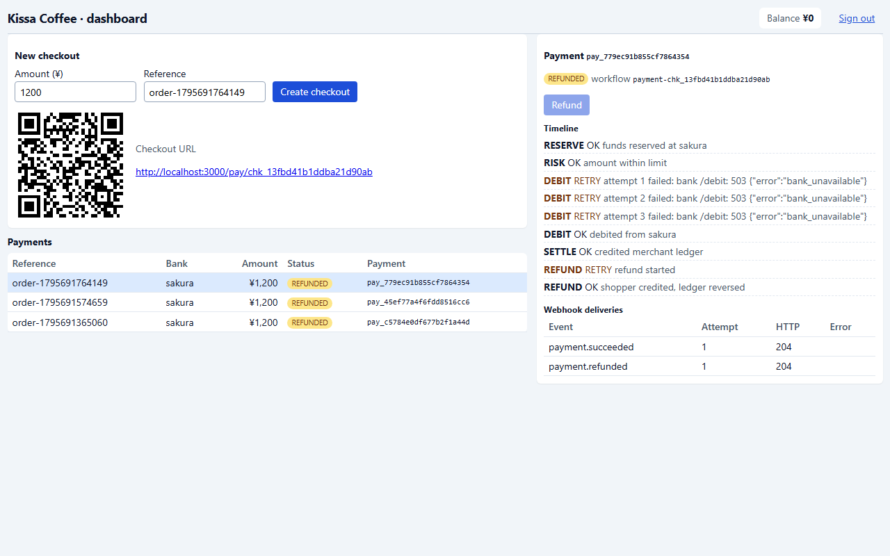
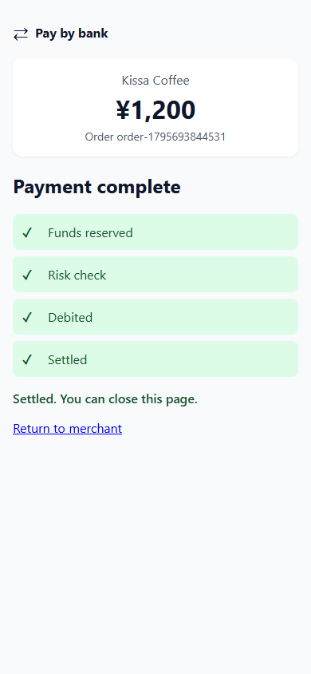
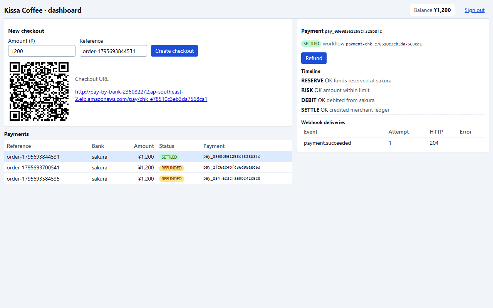
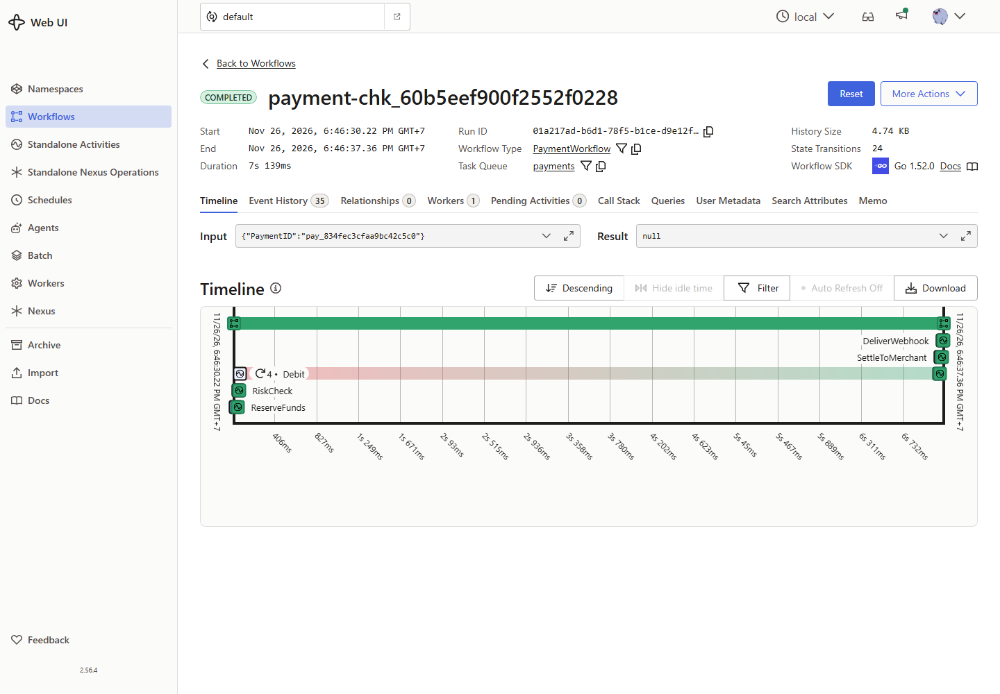

# Pay-by-Bank Checkout: a typed, durable payment flow

SvelteKit · React · Go · ConnectRPC · Protobuf · Temporal · PostgreSQL · AWS · Terraform

Source: the `pay-by-bank-checkout` repository. Everything below was run for real; the screenshots and logs are in [`proof/`](../proof/README.md).

## The problem

Card checkouts are expensive and slow to settle. Pay-by-bank lets the shopper approve a debit from their own bank account. Building one means coordinating several systems that fail independently (the bank, the ledger, the merchant's server) while the shopper watches a spinner and the merchant wants to see money arrive. The brief: build the whole flow end to end, from a mobile checkout to a merchant dashboard, with the parts that matter in payments done properly (money as integers, idempotency, retries, signed webhooks) and every layer of a modern fintech stack visible in running code.

**The demo:** the merchant "Kissa Coffee" creates a ¥1,200 checkout. The shopper pays from "Sakura Bank" while the mock bank fails debits. The checkout timeline still reaches *Settled*, Temporal's history shows the retried `Debit`, the merchant sees the payment appear live along with the signed webhook delivery, and then refunds it.

## Architecture





## Stack → requirement

| Requirement | Where it shows up |
|---|---|
| TypeScript, SvelteKit | `web/checkout`: SvelteKit 2 + Svelte 5, mobile-first and accessible shopper UI, `adapter-node` |
| React | `web/dashboard`: React 19 + Vite operator dashboard with live table, refund, QR code |
| Go | `services/{api,worker,mockbank,receiver}`: four small services in one module |
| ConnectRPC + Protobuf | `proto/pay/v1`, managed with `buf` (lint, breaking, generate); Go and TS clients generated and committed; server-streaming `WatchPayment` and `WatchMerchantPayments` |
| Temporal | `PaymentWorkflow` and `RefundWorkflow`: activities with retry policies, a cancel signal, a status query, compensation (release the reservation on a failed risk check) |
| PostgreSQL | `pgx` + `sqlc` queries, `goose` migrations (run as a one-off ECS task in the cloud) |
| Webhooks | HMAC-SHA256 signed (`t=…,v1=…`), delivered by a retrying activity, every attempt stored and shown in the dashboard |
| AWS | ECS Fargate (6 services), ALB path routing, RDS PostgreSQL 17, ECR, CloudWatch Logs, Cloud Map service discovery, S3 static hosting, SSM Parameter Store |
| Terraform | `infra/`: the whole stack (63 resources) created and destroyed from code |
| CI / testing | GitHub Actions: buf lint + "generate leaves no diff", go test, svelte-check, vitest, builds, Playwright end-to-end |
| Design thinking | [`docs/design/0001`](design/0001-payment-workflow.md) workflow proposal, [`0002`](design/0002-idempotency.md) idempotency, [ADRs](adr), [tech-debt register](tech-debt.md) |

## Screenshots

**Merchant creates a checkout** ([dashboard](../proof/phase1-local/screenshots/01-dashboard-new-checkout.png)); **the shopper pays on a phone-sized screen** ([bank select](../proof/phase1-local/screenshots/02-checkout-bank-select.png), [consent](../proof/phase1-local/screenshots/03-checkout-consent.png)):


**The dashboard updates live, with the retried debits in the payment's timeline and the signed webhook delivery:**



**Temporal UI: `Debit` retried before succeeding** (local, forced failures):


**Refund:** status `REFUNDED`, balance back to ¥0, `payment.refunded` webhook:



**The same story on AWS** (ECS Fargate behind an ALB, RDS, S3-hosted dashboard):





Cloud evidence: [`resources.txt`](../proof/phase2-cloud/resources.txt), [ECS services](../proof/phase2-cloud/logs/ecs-services.json), [CloudWatch worker log](../proof/phase2-cloud/logs/cloudwatch-worker.log), [mock bank failures](../proof/phase2-cloud/logs/cloudwatch-mockbank.log). After the capture the stack was destroyed and [`verify-destroyed.txt`](../proof/phase3-destroy/verify-destroyed.txt) shows nothing billable left.

## What was hard

- **Retries that stay honest.** With a 50% failure rate and 5 attempts, a payment would fail 3% of the time, which makes demos and tests flaky. The mock bank caps injected failures at 3 consecutive per idempotency key ([ADR 0003](adr/0003-mock-bank-failure-cap.md)), so retries are visible but the payment always settles. The bank also replays the first result per idempotency key, so a retried debit cannot double-debit.
- **Live status without a second source of truth.** Activities write `payment_events` and bump `updated_at` in the same transaction as the business change; the streaming RPCs poll that table ([ADR 0001](adr/0001-status-via-table.md)). It trades a bit of latency for atomicity and a read model every screen shares.
- **Duplicate submissions.** The workflow ID is `payment-<checkout_id>` with `USE_EXISTING` + `REJECT_DUPLICATE`, plus a unique `checkout_id` on payments, so a double tap or a crashed API attaches to the same payment instead of creating another ([0002](design/0002-idempotency.md)).
- **Streaming through real infrastructure.** Server streams cross an ALB with a 60 s idle timeout, so the server ends them after 20 s and clients transparently re-subscribe.
- **Cloud surprises.** AWS refused to create a CloudFront distribution (`Your account must be verified…`, needs AWS Support). The dashboard is served from S3 website hosting instead, and CloudFront remains in Terraform behind a variable ([ADR 0002](adr/0002-cloudfront-fronts-api.md)). That exposed a real bug: `crypto.randomUUID()` only exists in secure contexts, so idempotency keys on the plain-HTTP dashboard threw until they were generated with `crypto.getRandomValues`. Playwright against the real cloud endpoints caught it.
- **Cost discipline.** No NAT gateway, single-AZ `db.t4g.micro`, 0.25 vCPU tasks, 1-day log retention, force-destroyable buckets and repos, and `destroy.sh` / `verify-destroyed.sh` so nothing is left running.

## Approximate AWS cost

The stack was up for under an hour. Rough on-demand rates for `ap-southeast-2`: ALB about US$0.03/h, RDS `db.t4g.micro` about US$0.03/h, six small Fargate tasks about US$0.11/h in total. The run cost **well under US$1**, and nothing is running now.

## Reproduce

```bash
pnpm install
./scripts/dev-up.sh                     # local stack in Docker Compose + seed
./scripts/test-all.sh                   # lint, unit, integration, Vitest, Playwright
./scripts/capture-proof.sh phase1       # screenshots + logs into proof/phase1-local

# AWS (profile pay-by-bank-checkout-deployer, ap-southeast-2)
./scripts/deploy.sh                     # terraform, images, migrations, seed, cloud e2e + proof
./scripts/destroy.sh && ./scripts/verify-destroyed.sh
```

## Next steps

Real bank integration (open-banking consent redirect and certificates), per-merchant API key scopes and rotation, `LISTEN/NOTIFY` instead of polling, a persistent Temporal cluster, and mobile clients: the same protos generate Connect clients for Swift and Kotlin.
